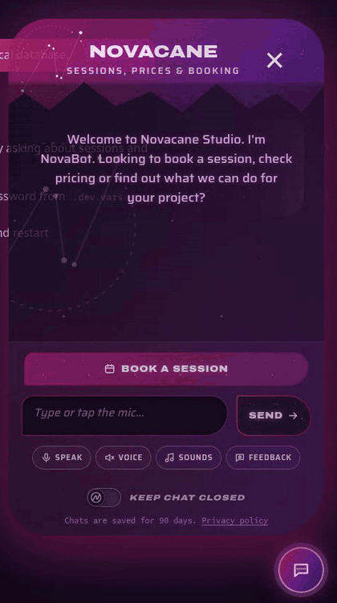
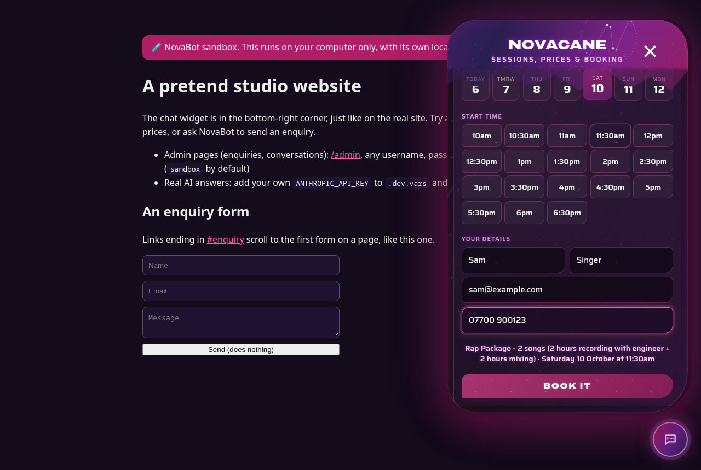
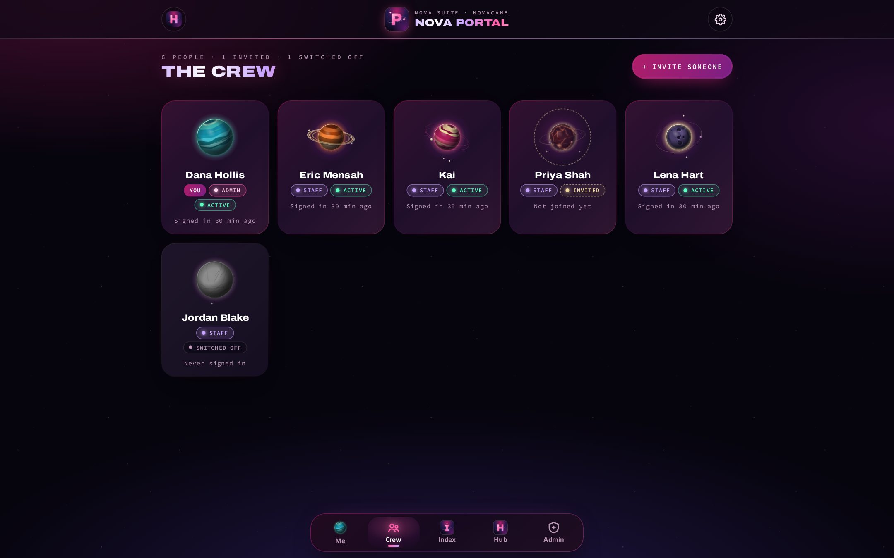
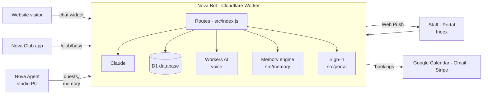
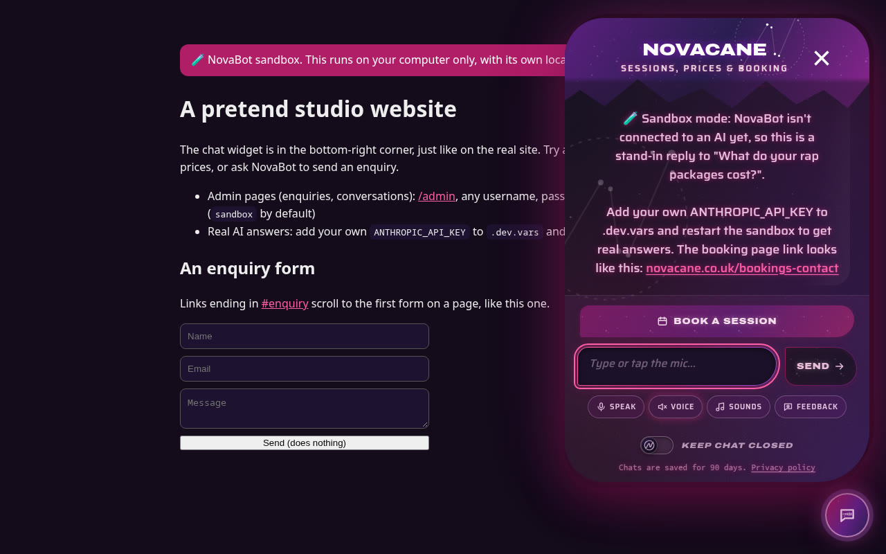

<div align="center">


# Nova Bot

**The front desk that never closes: a website assistant, a staff app and the engines behind Nova Agent, for Novacane Studios.**

[](https://developers.cloudflare.com/workers/)
[](https://www.anthropic.com/claude)
[-003B57?logo=sqlite&logoColor=white)](https://developers.cloudflare.com/d1/)
[](#tests)
[](https://github.com/tuniveza/nova-agent)
[](#licence)

</div>

---

Nova Bot runs on Cloudflare Workers for [Novacane Studios](https://novacane.co.uk), a
recording studio in London. One Worker does four jobs:

| | What it is | Where |
|---|---|---|
| ✦ **NovaBot** | The chat assistant on the studio's website. Answers questions with Claude and gets bookings ready, always with the deposit first | `public/novabot.js`, `src/index.js` |
| ✦ **Portal** | The staff app: enquiries, chats, a smart calendar, quests, alerts, a staff chat with NovaBot, sign-in, everyone's planet and the team | Nova Agent's Portal panel (copied into `public/portal/`), `src/app-page.js`, `src/portal/` |
| ✦ **Admin pages** | Password-protected pages for referrals, enquiries, conversations, feedback, the booking system and the master list of links | `src/admin.js` |
| ✦ **Suite engines** | The memory behind **Index** and the sign-in behind **Portal**, shared by every Nova app | `src/memory/`, `src/portal/` |

It comes with a **sandbox**, so you can run the whole thing on your own computer without
any accounts.

> Every screenshot and animation here was made with made-up data (Dana Hollis, Eric
> Mensah, Kai and friends, `example.com` addresses and `07700 900xxx` numbers). No real
> customers appear anywhere.

## Contents

- [NovaBot, on the website](#novabot-on-the-website)
- [Portal, the staff app](#portal-the-staff-app)
- [The admin pages](#the-admin-pages)
- [Index: the memory engine](#nova-index-the-memory-engine)
- [Portal: one sign-in for the suite](#nova-portal-one-sign-in-for-the-suite)
- [How it works](#how-it-works)
- [Run it locally (sandbox)](#run-it-locally-sandbox)
- [The build step](#the-build-step)
- [Configuration](#configuration)
- [Bookings](#bookings-nova-bots-own-booking-system)
- [Tests](#tests)
- [Deploying your own copy](#deploying-your-own-copy)
- [Project layout](#project-layout)
- [Works with Nova Agent](#works-with-nova-agent)

## NovaBot, on the website

<table>
  <tr>
    <td width="50%"></td>
    <td width="50%"><br><sub>The chat widget on a page.</sub><br><br><br><sub>The booking card: session, day, free start times and details, all in the chat.</sub></td>
  </tr>
</table>

- **It answers questions** (`src/index.js`). Claude answers from the studio's own
  information: prices, policies and booking rules. Every link it gives is checked, and
  anything made up is replaced with a real one.
- **Bookings** (`src/nova/`): Nova Bot's own booking system. The booking page (`/book`), the
  studio's Google Calendar as the diary, emails from the studio's Gmail, and a 50% deposit
  through Stripe. On the website, the customer books by paying the deposit; in Portal's
  staff chat NovaBot books for them and emails the deposit link. Changes to a booking that
  an AI suggests wait for an admin's Approve in Portal → Approvals.
- **The chat widget** (`public/novabot.js`, `public/novabot.css`): opens after the page
  loads, keeps out of the way of buttons and forms, remembers the conversation across
  pages, and has a "Keep chat closed" switch. Optional voice: speak to it (Whisper on
  Workers AI) and hear replies (the browser's voice or MeloTTS).
- **Booking links and free times** (`src/nova/booking.js`): the sessions and prices in
  `src/nova/studio.js`, and the free start times in the studio's Google Calendar.
- **The booking card** (`src/nova/booking-form.js`): "Book a session" opens a card in the chat
  with the session, a strip of days, that day's free times and the visitor's details. The
  Worker checks the time again before anything happens.
- **Enquiries** (`src/enquiries.js`): NovaBot can take an enquiry, show the visitor a
  summary, and send it to the team once they confirm. It's saved for Portal and the
  admin pages, and can be emailed (the studio's own mail server).
- **Safety**: per-visitor rate limits, only allowed websites can use the chat, spam
  limits on enquiries, and IP addresses stored only as a hash.

## Portal, the staff app

The staff app (enquiries, website chats, bookings, alerts, Ask NovaBot and push to the
staff phones, plus sign-in, everyone's planet and the team) is Nova Agent's **Portal**
panel. Portal is part of it now. Its pages live in Nova Agent's repo (`web/portal`) and are
copied in at build time (see [The build step](#the-build-step)). Online it's at
`/portal/`; this Worker is its back end (`/app/api/*`, `src/app-page.js`, and `src/portal/`
for sign-in and the team). Portal's old address, `/app/`, redirects to Portal, but phones
that installed Portal keep their push helper (`/app/sw.js`). Its guide and pictures are in
Nova Agent's `docs/apps/portal`.

## The admin pages

`/admin`, in Portal's look and themes. Sign in with Portal as an admin; signed out,
it sends you to Portal and back.

| Page | What's there |
|---|---|
| **Referrals** (`/admin`) | Referral codes, the appointments they brought in, and a CSV report |
| **Enquiries** | Every enquiry, mark done, and a test email |
| **Conversations** | Recent chats (kept 90 days), one in full with `?chat=ID` |
| **Feedback** | What visitors said about NovaBot, good and bad |
| **Booking system** (`/admin/connections`) | Google and Stripe for bookings, recent booking emails, and **Bring Acuity's bookings over** (`/admin/import-acuity`, a one-off) |
| **Links** (`/admin/links`) | The master list: every address with a live check, **What's changed**, and **everything the suite can do**. Edited here as JSON |

<p align="center">
  <br>
  <sub>The Links page's changelog (sample entries).</sub>
</p>

The master list is kept in the database (`settings`), never in the code, because the code
is public. Portal's Nova Agent sheet reads the same list from `/app/api/links`
(`src/links.js`).

## Index: the memory engine

<p align="center">
  <br>
  <sub>Index, browsing the suite's memory (sample data).</sub>
</p>

`src/memory/` is one shared memory for Nova Agent. Nova Agent's Index panel (copied in at
`/app/memory/`) is the window onto it; NovaBot, Portal and Nova Agent read and add to it.

**How it's kept.** Small files of one-line facts, one file per subject, in D1 (never in
git). Each line is tagged: `[stated]` said directly, `[observed]` seen in bookings or
behaviour, `[inferred]` a pattern. Files stay small (about 3 KB; a condense pass tidies
them), and at most about 800 tokens of memory go into any one prompt.

**Scopes, and who sees what.** The caller's role decides, never what it asks for.

| Scope | Holds | Read by | Written by |
|---|---|---|---|
| `studio` | The studio's shared facts: people, topics, areas | Staff, Nova Agent, Portal members | Staff, Nova Agent |
| `staff` | Each staff member's own partition | Staff, Nova Agent; a Portal member sees only their own | Staff, Nova Agent, the member themself |
| `customer` | One file per client (their email, or the chat until it's known) | Staff; NovaBot on the website sees only *that* customer's file | Staff (website facts wait for approval) |

**What it learns, and when.** Always in the background, never while someone waits:

- **Portal's staff chats**: facts are saved straight away (staff are trusted).
- **Website chats**: the every-minute job reads a chat once it's been quiet for 10 minutes
  (or every 20 messages), two chats a run. Facts about clients go into an **approval
  queue** in Index instead of being saved.
- **Nova Agent**: hands over conversation chunks with `POST /memory/extract`.

Each pass asks a small model for **durable** facts only ("would this still be true and
useful in three months?"), and folds them into the file: a new line on the same subject
replaces the old one rather than contradicting it. Writes carry a version token, so two
apps can't overwrite each other.

**Privacy.** Card numbers, bank details, sort codes, National Insurance and passport
numbers and passwords are refused at the door. Nothing is learned while a visitor waits.
The website only ever sees the public studio file and that customer's own file, and client
facts need a person to approve them.

<details>
<summary><b>The API</b></summary>

For Nova Agent (`Authorization: Bearer <AGENT_NOVA_KEY>`):

| Route | Does |
|---|---|
| `GET /memory/context?scope=&owner_id=&q=` | The files that matter for this turn, as text |
| `GET /memory/file?scope=&owner_id=&path=` | One file and its version token |
| `PUT /memory/file` | Write a file (`if_version: "new"` or the token; 409 with the current file on a clash) |
| `POST /memory/extract` | Hand over a conversation chunk; learned in the background (202) |
| `GET /memory/index?scope=` | The listing (no bodies) |

For Portal and Index (signed in), under `/app/api/memory/`: `index`, `file`
(GET/PUT/DELETE), `pending`, `pending/:id` (approve or reject, optionally with an edited
fact), and `stats`.

</details>

## Portal: one sign-in for the suite

<table>
  <tr>
    <td width="50%"><br><sub>Sign in once for every Nova app.</sub></td>
    <td width="50%"><br><sub>The crew, each with their own planet (sample people).</sub></td>
  </tr>
</table>

`src/portal/` signs people in once for Portal, Index and the admin pages. The
pages are Nova Agent's Portal panel (`web/portal` in Nova Agent's repo), copied in at build time
(see [the build step](#the-build-step)); this Worker serves them at `/portal/` and runs the API.

- **Accounts.** Everyone has their own (`staff` table): a readable id like `dana`, an
  email, a display name, a role and a status (active, invited or switched off). The first
  admin is set up with the studio's current password.
- **Invites.** An admin invites someone by email and gets a link that works once, for 7
  days. Only a hash of its token is stored. The new person chooses a password and is
  signed in.
- **Passwords.** PBKDF2-SHA256 with 100,000 rounds and a random salt for each person; a
  few tries a minute at most per address.
- **Sessions.** A random token in an httpOnly, Secure cookie for 30 days (or an app token,
  `Authorization: Bearer nsess_…`, for native apps). Only its SHA-256 is stored, and
  signing out deletes it, so it stops working everywhere at once.
- **Roles.** `admin` (everything, including the crew and the admin pages) or `staff`.
  A staff member who isn't an admin sees the studio's memory and their own partition of
  Index.
- **Planets.** Every person gets a planet, drawn fresh from their seed by the planet
  generator: `GET /staff/:id/planet.svg?size=&animate=1`. It's their avatar across the
  suite.
- **One sign-in.** There's no shared password any more: Portal, Index, the admin pages and
  every other panel take a Portal sign-in.

<details>
<summary><b>The API</b></summary>

| Route | Does |
|---|---|
| `POST /auth/login` | `{ email, password, client? }` → session cookie (or an app token) |
| `POST /auth/logout` | Ends this session everywhere |
| `GET /auth/me` | Who's signed in (every app starts with this) |
| `GET /auth/status` | `{ setupNeeded }` |
| `POST /auth/setup` | The first admin, proven with the studio's current password |
| `GET /auth/invite?token=` / `POST /auth/invite/accept` | Who an invite is for; choose a password |
| `GET /staff`, `POST /staff` | Admins: everyone; invite someone |
| `POST /staff/:id/invite` | Admins: a fresh invite link |
| `GET /staff/:id`, `PATCH /staff/:id` | A profile; change it (admins: role and status too) |
| `GET /staff/:id/planet.svg` | The planet badge |
| `GET /staff/:id/index` | That person's Index view |

Changes from a browser must come from this site (the Origin header).

</details>

## How it works



- **One Worker** serves the widget, the chat API, Portal, Index, the
  admin pages, webhooks and a once-a-minute cron (holds let go, reminders, Google, and
  reading website chats for memory).
- **D1** holds enquiries, chat logs (90 days), referral codes, notifications, settings,
  the memory files, staff accounts and sessions, and the bookings (`migrations/`).
- **Secrets** live in Cloudflare (`wrangler secret put`), never in the code.

## Run it locally (sandbox)

You need [Node.js](https://nodejs.org) 20 or newer. No Cloudflare, Claude, Google or
Stripe account is needed.

```sh
git clone https://github.com/tuniveza/nova-bot.git
cd nova-bot
npm install
npm run sandbox:setup   # creates .dev.vars from the example, and a local database
npm run sandbox         # starts it at http://localhost:8787
```

Open <http://localhost:8787>: a pretend website with the chat widget on it.

<p align="center">
  <br>
  <sub>The sandbox: a pretend studio site, with clearly labelled stand-in replies when no AI key is set.</sub>
</p>

- **Everything stays on your computer.** The sandbox has its own local database and
  can't reach any live Nova Bot, database or calendar.
- **Without an AI key**, NovaBot gives clearly labelled stand-in replies, so you can try
  the widget, enquiries, Portal and the admin pages for free.
- **For real answers**, put your own Claude API key
  ([console.anthropic.com](https://console.anthropic.com)) in `.dev.vars` as
  `ANTHROPIC_API_KEY=...` and restart. That uses your own Anthropic account.
- **Admin pages and Portal**: <http://localhost:8787/admin> and
  <http://localhost:8787/portal/>; set up the first admin with the password in `.dev.vars` (`sandbox`).
- **The booking card** works offline in the sandbox: no Google key means the "calendar"
  is the local bookings table; no Stripe key means a local stand-in checkout.
- **Voice**: speech uses your browser's own voice; the microphone needs Workers AI, so
  it isn't available in the sandbox.

`.dev.vars` is in `.gitignore`: your keys never get committed.

## The build step

Nova Agent's panels (Portal, Index, Calendar, Notes, and what they share) live in
Nova Agent's repo (`na/web`). They're served from here online, so they share this
Worker's sign-in, so before every deploy or local run, wrangler's build step
(`"build": { "command": "node scripts/sync-apps.mjs" }`) copies them in:

| From (Nova Agent) | To | What |
|---|---|---|
| `web/portal/` | `public/portal/` | Portal |
| `web/portal/old-app-address/` | `public/app/` | What phones that installed Portal from `/app/` still use: its push helper, manifest and icons |
| `web/index/` | `public/app/memory/` | Index |
| `web/calendar/`, `web/notes/` | `public/calendar/`, `public/notes/` | Calendar and Notes (online, they save in the browser) |
| `web/shared/` | `public/shared/` | Themes, sounds, the badge and the Manual |
| `web/portal/planet/` | `src/portal/planet/` | The planet generator (also draws `planet.svg`) |

Nova Agent is expected at `../../na`; `NOVA_AGENT_DIR` points elsewhere. The page copies are
never saved in this repo (`.gitignore`). The planet generator copy is, so the project
still builds and tests on its own.

**Addresses**: Portal at `/portal/`, Index at `/app/memory/`. Portal's old pages (`/app/`,
`/app/?view=alerts` and so on) redirect to Portal (`src/index.js`, `movedPage`); its API
(`/app/api/`) and the files in `public/app/` stay. The addresses the panels had for a day
(`/studio/`, `/crew/`, `/index/`) redirect too.

## Configuration

Everything secret is a **Wrangler secret** (`npx wrangler secret put NAME`), or a line in
`.dev.vars` for local runs. Names only; values never belong in the repository.

| Name | Needed for |
|---|---|
| `ANTHROPIC_API_KEY` | Claude answers and memory (required live) |
| `ADMIN_PASSWORD` | Only proves it's you when setting up the very first Portal admin |
| `ACUITY_CALENDAR_URL` | Only for bringing Acuity's future bookings over, once (`/admin/import-acuity`); not needed after |
| `AGENT_NOVA_KEY` | Nova Agent's routes (`/nova-agent/*`; `/memory/*`), and its online link (`/nova-agent/link`, the AgentLink Durable Object in `src/agent-relay.js`: Nova Agent's chat, Missions, Quests, Calendar and Visualizer online, through the studio PC) |
| `VAPID_PUBLIC_KEY`, `VAPID_PRIVATE_KEY` | Phone notifications (Web Push) |
| `MAIL_API_URL`, `MAIL_KEY`, `ENQUIRY_EMAIL_TO`, `ENQUIRY_EMAIL_FROM` | Emailing (the studio's own mail server on the VPS; enquiries, replies, invoices, newsletters) |
| `GOOGLE_CLIENT_ID`, `GOOGLE_CLIENT_SECRET` | Optional: Admin → Google keeps the same key without them (Notes' Google Docs, Calendar and Gmail for bookings; Google is never a way to sign in, Portal is) |
| `GOOGLE_REFRESH_TOKEN`, `GOOGLE_CALENDAR_ID`, `GOOGLE_ACCOUNT` | Optional overrides; normally set by "Connect Google" on `/admin/connections` |
| `STRIPE_SECRET_KEY`, `STRIPE_WEBHOOK_SECRET` | Bookings: deposits and payments |

Plain variables (in `wrangler.jsonc` or `--var`): `PUBLIC_URL`, `SANDBOX`.

Bindings in `wrangler.jsonc`: `DB` (D1), `AI` (Workers AI), `CHAT_LIMIT`, `VOICE_LIMIT` and
`CLUB_LIMIT` (rate limits), static assets from `public/`, the build step, and a cron
trigger every minute.

More detail lives alongside this file:
[README-ENQUIRIES.md](README-ENQUIRIES.md) (enquiries, booking links, free times, chat log),
[README-REFERRALS.md](README-REFERRALS.md) (referral codes),
[README-SQUARESPACE.md](README-SQUARESPACE.md) (adding the widget to a Squarespace site) and
[PRIVACY-POLICY-NOVABOT.md](PRIVACY-POLICY-NOVABOT.md) (privacy policy wording).

## Bookings: Nova Bot's own booking system

`src/nova/` is the booking system (Acuity isn't used any more, 24 Oct 2026):

- **Booking page** at `/book`, with the studio's **Google Calendar** as the diary,
  confirmation emails from the studio's **Gmail**, and deposits through **Stripe**.
- **Customer pages**: each customer gets a page to pay, move or cancel.
- **Staff tools** in Portal: cancel, move, refund and send payment links. A change an AI
  suggests (Nova Agent, or Portal's staff chat) waits in Portal → Approvals
  (`src/booking-actions.js`, `src/nova/booking-changes.js`).
- **The client list** follows every booking (`src/clients.js`), and Nova Club's Tap to Pay
  can take a payment for a booking (`src/nova/club-terminal.js`).
- **Bringing Acuity's bookings over** (a one-off): `/admin/import-acuity` lists every future
  booking in Acuity's calendar feed and what would happen to it; **Bring them over** puts them
  in, with no emails and no charges, and is safe to press again (`src/acuity-import.js`, to be
  removed once that's done).

<details>
<summary><b>Setting it up</b></summary>

1. **Google:** in Nova Agent, Admin → Google walks through it a step at a time (Google
   Cloud's pages open from buttons, with copy buttons for every address to paste), then takes
   the key and has a **Connect Google** button. The same key gives everyone **Sign in with
   Google** and Notes' Google Docs. (Setting `GOOGLE_CLIENT_ID` and `GOOGLE_CLIENT_SECRET` as
   secrets still works, and wins.)
2. **Stripe:** `npx wrangler secret put STRIPE_SECRET_KEY` (use a `sk_test_…` key to try
   it). Add a webhook endpoint `https://<worker>/stripe/webhook` with the events
   `checkout.session.completed`, `checkout.session.async_payment_succeeded` and
   `checkout.session.expired`, and save its signing secret as `STRIPE_WEBHOOK_SECRET`.
3. **Database:** `npx wrangler d1 migrations apply novabot --remote`.
4. **Deploy,** then on `/admin/connections`: press **Send a test email**, and try a booking
   in Admin → Test booking.

Sessions, prices and rules (opening hours, 50% deposit, 48-hour cancellation) are in
`src/nova/studio.js`.

</details>

## Tests

```sh
npm test            # watch mode
npx vitest run      # once
```

About 850 tests across 61 files, fully offline: they run inside the Workers runtime
(`@cloudflare/vitest-plugin`) with a local database and fake versions of Claude, Google,
Stripe and the mail server (`test/fakes.js`). Every key in `vitest.config.mjs` is a
test-only stand-in. `test/switch.spec.js` tests the VPS pass-through. The memory engine and
Portal have their own (`test/memory.spec.js`, `test/portal.spec.js`).

## Deploying your own copy

1. Log in to Cloudflare: `npx wrangler login`.
2. Create the database: `npx wrangler d1 create novabot`, put its `database_id` in
   `wrangler.jsonc`, then `npx wrangler d1 migrations apply novabot --remote`.
3. Add the secrets you need from [Configuration](#configuration), at least
   `ANTHROPIC_API_KEY` and `ADMIN_PASSWORD`.
4. Swap Novacane's details for your own:
   - `src/index.js`: `BOOKING_LINK`, `ENQUIRY_LINK`, `WHATSAPP_NUMBER`, `WHATSAPP_LINK`,
     `ALLOWED_ORIGINS`, and the studio information in `STUDIO_INFO`
   - `src/nova/studio.js` and `src/nova/booking.js` (`LIVE_URL`) for bookings
   - `public/novabot.js`: `LIVE_WORKER_URL`, `BOOKING_LINK`, `PRIVACY_LINK`
5. Deploy with `npm run deploy` (the build step copies Index and Portal in), then
   add the widget to your website (see [README-SQUARESPACE.md](README-SQUARESPACE.md)).
6. Open `/portal/` to set up the first admin with the studio password, then invite the team.

## Project layout

```
public/novabot.js, novabot.css   the chat widget (served by the Worker)
public/app, portal, calendar, … Nova Agent's panels, copied in at build time (not in this repo)
  app.js, app.css                  the tabs, the smart calendar, alerts, voice, pings
  suite.js                         Nova Agent sheet, All links, What's changed
  options.js, themes.js/.css       Options and the six themes
  ambient.js, sfx.js               ambient music and sound effects
  sw.js                            notifications with the app closed
  memory/                          Index (copied in at build time, not in git)
public/portal/                   Portal's pages (copied in at build time, not in git)
src/index.js                     the Worker: chat, voice, routes, NovaBot's instructions
src/app-page.js                  Portal's staff API (/app/api/*, from Portal's old address)
src/portal-ask.js                Ask Nova: questions about bookings, enquiries and alerts
src/admin.js                     the admin pages
src/links.js                     the master list: links, features, changelog
src/memory/                      the memory engine (store, extract, routes)
src/portal/                      Portal: sign-in, sessions, staff, planets
src/booking-actions.js           Approvals: booking changes an AI suggests and an admin approves
src/acuity-import.js             bringing Acuity's future bookings over (one-off)
src/agent-nova.js                check-ins, quests, alerts and read-only tools for Nova Agent
src/enquiries.js                 enquiries, enquiry emails, chat log
src/push.js                      notifications and the Alerts tab
src/clients.js                   the client list
src/referrals.js                 referral codes and the "Did anyone refer you?" page
src/feedback.js                  what visitors said about NovaBot
src/uk-time.js                   UK time helpers
src/nova/                        the booking system (Google Calendar, Gmail, Stripe), Nova Club's
                                 busy times and Tap to Pay
src/fonts/                       Saira, Geist Mono and Source Code Pro (SIL OFL)
migrations/                      D1 tables
test/                            Vitest tests and fakes
scripts/sync-apps.mjs            the build step: copies Index and Portal in
scripts/sandbox-setup.mjs        sandbox setup
docs/media/                      README images (all sample data)
```

## Works with Nova Agent

| Project | What it is |
|---|---|
| [nova-agent](https://github.com/tuniveza/nova-agent) | The studio's one app: chat, Missions and Quests, and every panel (Portal, Calendar, Notes, Index, Observatory, Lossless audio). On the studio PC, and online from here for phones |
| **[nova-bot](https://github.com/tuniveza/nova-bot)** | This repo: NovaBot on the website, and the back end behind Nova Agent (sign-in, push, bookings, the memory engine, jobs) |
| [nova-club](https://github.com/tuniveza/nova-club) | Members' Android app that shows the studio's busy times |

## Licence

All rights reserved — Novacane Studios. The bundled fonts in `src/fonts/` keep their own
SIL Open Font Licence (see the `OFL.txt` files).
